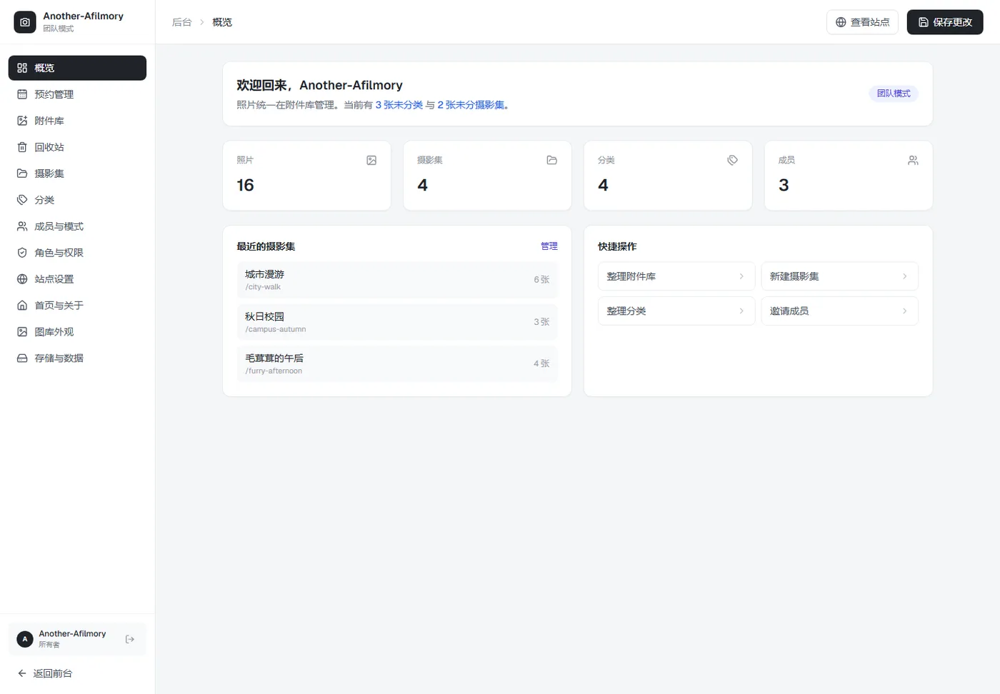

# Another-Afilmory

**Another-Afilmory** 是一个基于 [Afilmory](https://github.com/Afilmory/afilmory) 二次开发的个人摄影站，包含作品瀑布流、摄影集/分类、约拍预约、关于页、统一深色界面，以及一套本地优先的后台管理系统。

> 当前仓库以 **AGPL-3.0-or-later** 发布，详见 [LICENSE](LICENSE)。


## 功能

- **首页**：桌面端横向手风琴照片墙，鼠标悬停轻微展开；移动端自动切换为单张交叉淡入轮播。支持随机/手动选片、展示数量、轮播间隔，右下角计数与圆点选择器。
- **作品页**：瀑布流/列表两种视图，支持相机、镜头、时间、上传者筛选与返回顶部。
- **摄影集**：3D 文件夹式入口卡片（封面 + 第 2/3 张照片叠层），详情页复用首页瀑布流，打开照片后关闭会回到当前摄影集。
- **分类**：与摄影集一致的入口和详情，照片可同时属于多个分类。
- **约拍预约**：日期、时间、拍摄内容、付费/免费、QQ/微信/邮箱/电话与备注，提交后写入 SQLite；后台可筛选、改状态、删除。
- **关于页**：头像、简介、年龄/所在地、主图、地图入口、联系方式，以及带图片/资产编号/品牌/型号的设备清单。
- **后台 `/console`**：账号登录、角色与权限、附件库、摄影集、分类、成员、预约管理、回收站、站点/图库/首页设置、存储与数据备份。
- **统一附件库**：所有照片集中管理，支持未分类、未分摄影集筛选，单张/批量归类，上传、删除、重新索引。
- **本地优先**：内容、账号、预约、回收站全部存 SQLite；照片存本地目录；不依赖云存储。



## 技术栈

- React 19 + Vite 8 + TypeScript
- Tailwind CSS 4 + Motion
- Jotai、React Router、TanStack Query/Virtual
- Hono / Drizzle / PostgreSQL 保留在官方 `be/` 目录中，当前个人站后台使用 Vite 插件内置 API
- `node:sqlite`（Node 22+ 内置）、scrypt 密码哈希
- Sharp（缩略图/预览图）、exif 读取

## 本地运行

环境要求：

- Node.js **22+**（推荐 24）
- pnpm **12+**
- Windows 下如果没有 `sh`，请使用 `--ignore-scripts` 安装并手动复制配置

```bash
git clone <your-repository-url> another-afilmory
cd another-afilmory

# 安装依赖；Windows 没有 sh 时跳过 preinstall
pnpm install --ignore-scripts

# 首次配置
cp config.example.json config.json
cp builder.config.default.ts builder.config.ts
```

`builder.config.ts` 使用本地存储，示例：

```ts
storage: {
  provider: 'local',
  basePath: './photos',
  baseUrl: '/photos',
  distPath: './apps/web/public/photos',
  maxFileLimit: 1000,
  excludeRegex: '^_',
}
```

把原始照片放进 `photos/`，然后生成缩略图和 manifest：

```bash
pnpm build:manifest
```

启动开发服务器（局域网可访问）：

```bash
pnpm dev:lan
```

- 前台：http://localhost:5199/
- 后台：http://localhost:5199/console
- 作品：http://localhost:5199/gallery
- 预约：http://localhost:5199/booking
- 关于：http://localhost:5199/about
- RSS：http://localhost:5199/feed.xml

> `pnpm dev:lan` 监听 `0.0.0.0:5199`，同一局域网设备可通过本机 IPv4 访问。若系统防火墙拦截，请放行 TCP 5199。

### 首次初始化

删除 `content/afilmory.db` 后首次访问 `/console`，会跳转 `/console/setup`，创建第一个管理员账号并设置站点名称。

当前仓库自带演示数据库时，可使用：

| 账号 | 密码 | 角色 |
| --- | --- | --- |
| `owner@another-afilmory.local` | `admin123` | 所有者 |
| `linyi@another-afilmory.local` | `photo123` | 编辑 |
| `ache@another-afilmory.local` | `photo123` | 投稿者 |

生产环境请删除演示数据库，走初始化流程并更换所有密码。

### 修改所有者密码

已登录时：后台左侧「成员与模式」→ 找到所有者这一行 → 点击「密码」→ 输入至少 6 位新密码。修改后当前会话仍然有效，下次登录使用新密码。

如果已经无法登录，在仓库根目录执行：

```bash
pnpm reset:password owner@another-afilmory.local "你的新密码"
```

该命令会更新 `content/afilmory.db` 中的 scrypt 哈希，并让该账号的旧会话失效。也可以通过 `AFILMORY_ADMIN_PASSWORD` 环境变量设置新账号的初始密码。

## 数据与存储

- `content/afilmory.db`：SQLite 内容库（站点设置、成员、摄影集、分类、照片元数据、角色、预约、回收站、会话）。
- `content/backups/`：每次保存自动生成的数据库备份，保留最近 10 份。
- `photos/`：原始照片。
- `apps/web/public/photos/`：对外提供的本地原图副本。
- `apps/web/public/thumbnails/`：瀑布流缩略图。
- `apps/web/public/previews/`：首页 1600px 预览图。
- `content/admin-data.json`：首次启动的种子数据，之后不再写入。

备份与恢复入口：后台「存储与数据」→ 导出数据 / 导入数据 / 立即备份。

## 角色与权限

内置角色：所有者、管理员、编辑、投稿者、访客。所有者与管理员拥有全部权限；编辑可管理照片、摄影集和分类；投稿者只能查看/编辑/删除自己的照片；访客只读。

后台「角色与权限」可以新建自定义角色，按分组勾选权限，覆盖附件库、摄影集、分类、成员、角色、站点设置、图库外观、存储等全部功能区。权限同时在服务端校验。

## 目录结构

```text
apps/web/
  src/
    pages/          # 首页、作品、摄影集、分类、预约、关于、console
    modules/        # gallery / discover / viewer / map / metadata
    lib/admin/      # 内容类型、权限、预约、附件客户端
  plugins/vite/     # admin-data / admin-db / admin-files / feed-sitemap
  public/           # photos、thumbnails、previews、图标
content/            # SQLite、备份、首次种子
photos/             # 原始照片
docs/               # 自定义后台说明、截图
packages/           # 官方 Afilmory 包（builder、data、ui、typing 等）
be/                 # 官方 Hono/Postgres/Redis 后端（当前个人站未启用）
```

## 已知限制

- 登录、保存、上传 API 由 Vite 开发服务器提供；直接部署 `apps/web/dist` 静态文件时没有 `/api/*`，后台登录/保存不可用。
- 当前照片存储固定为本地 `local`，不支持 S3/GitHub。
- 预约与后台管理接口未接入官方 `be/apps/core` 的多租户/计费体系。
- 官方 `be/` 的 Redis/PostgreSQL 配置保留但未启用；个人站的数据链路完全走 SQLite。
- 仓库不再包含 Dockerfile / docker-compose；部署使用 Node + pnpm，照片、SQLite 与预览图都保存在本地目录。

## 致谢

本项目站在很多开源项目与设计参考之上：

- [Afilmory](https://github.com/Afilmory/afilmory)：基础架构、构建器、查看器与设计系统。
- [Halo](https://halo.run)：后台管理界面的视觉与交互参考。
- [p.javai.cn/gallery](https://p.javai.cn/gallery)：摄影集/分类入口卡片样式参考。
- [yangge2333.wiki](https://yangge2333.wiki/)：首页手风琴照片墙与竖图切换参考。
- [lyhxx/photography-station](https://github.com/lyhxx/photography-station)：3D 文件夹式相册布局参考。
- [MapLibre GL JS](https://maplibre.org/) 与 [OpenStreetMap](https://www.openstreetmap.org/)：地图能力与地图数据。
- 以及 React、Vite、Tailwind CSS、Motion、Jotai、Radix UI、Sharp、exif 工具等所有依赖的作者与维护者。

摄影作品版权归原作者所有，未经许可请勿转载。

## 许可证

本项目以 **GNU Affero General Public License v3.0 or later（AGPL-3.0-or-later）** 发布。

你可以自由使用、修改和分发本项目，但通过网络向用户提供服务时，必须按 AGPL 第 13 条提供对应的完整源代码。完整条款见 [LICENSE](LICENSE)。

Afilmory 原项目的版权与许可信息保留在 [LICENSES/Afilmory-ANL.md](LICENSES/Afilmory-ANL.md)；本仓库仅对本项目新增与修改部分按 AGPL-3.0-or-later 授权，修改日期见仓库提交记录。
